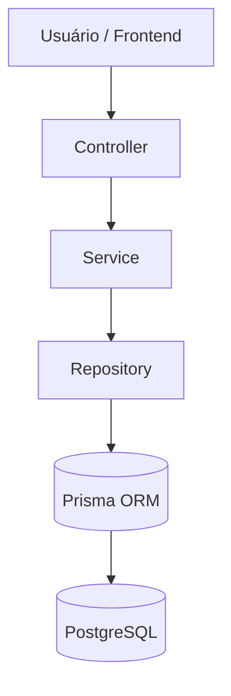
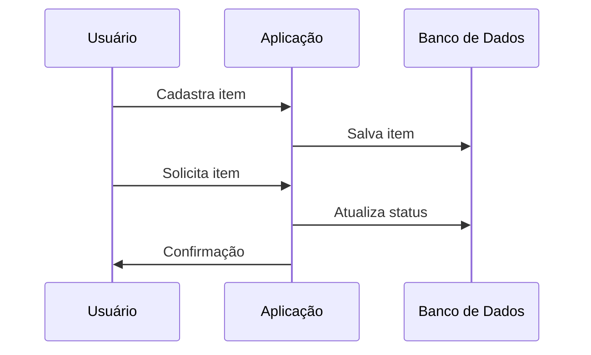
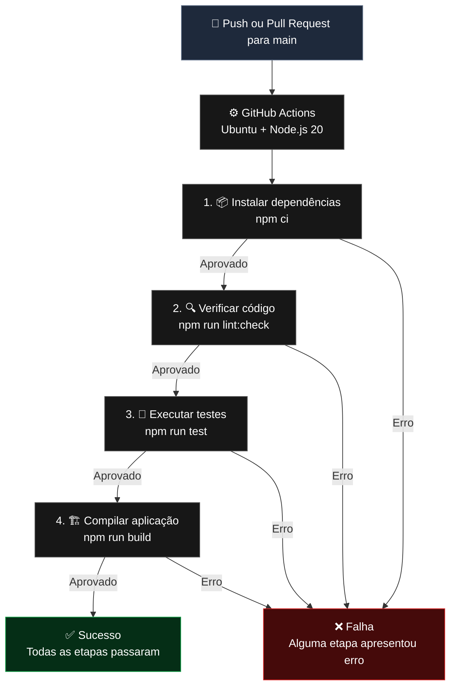

<p align="center">
  
</p>

<h1 align="center">Passe Adiante</h1>
<h3 align="center">Um caderno a menos parado, um estudante a mais preparado.</h3>

<p align="center">
  
  
  
  
  
</p>

---

## 📌 Sobre o Projeto

O **Passe Adiante** é uma plataforma web desenvolvida para conectar doadores e estudantes em situação de vulnerabilidade econômica, promovendo o reaproveitamento de materiais escolares e incentivando práticas de consumo consciente e economia circular.

---

## 📑 Índice

* [🎯 Motivação](./docs/motivation.md)
* [🏗 Arquitetura e Organização](./docs/architecture-and-organization.md)
* [✨ Possíveis usos da nossa solução](./docs/possible-users-of-solution.md)
* [🛠 Manual de Instalação](./docs/instalation-manual.md)
* [🔁 Comandos Básicos do Git](./docs/basics-git-commands.md)
* [⚙️ Integração Contínua](#integracao-continua)
* [🧪 Testes](#-testes)
* [🤝 Contribuição](#-contribuição)
* [📄 Licença](#-licença)

---

## 🧩 Arquitetura da Aplicação


---

## 🔄 Fluxo de Doação de Material


---

<a id="integracao-continua"></a>

## ⚙️ Integração Contínua

### Objetivo

Automatizar a validação do código, verificando se ele segue os padrões definidos, passa nos testes e consegue ser compilado sem erros.

### Configuração

O arquivo .github/workflows/ci.yml contém as instruções que o GitHub Actions deve executar. Ele define quando, onde e como as verificações acontecerão.

### Gatilhos

São os eventos que iniciam a execução automática:
- Push na main: quando alguém envia alterações diretamente para a branch principal, inclusive após um merge.
- Pull Request para main: quando alguém propõe integrar alterações à branch principal.

### Ambiente

As verificações são executadas em uma máquina virtual disponibilizada pelo GitHub, utilizando:
- Ubuntu: sistema operacional Linux.
- Node.js 20: ambiente de execução do JavaScript.
Isso permite testar o projeto em um ambiente padronizado, independentemente do computador do desenvolvedor.

### Etapas

| Comando | Finalidade |
| --- | --- |
| `npm ci` | Instala as dependências conforme o `package-lock.json`, de maneira reproduzível. |
| `npm run lint:check` | Analisa o código para identificar problemas e violações dos padrões definidos. |
| `npm run test` | Executa os testes automatizados para verificar o funcionamento da aplicação. |
| `npm run build` | Tenta compilar ou gerar a versão de distribuição da aplicação. |

Os três últimos comandos dependem de scripts definidos no package.json.

**Resumindo**




**Importante:** a CI não impede automaticamente que um código com erro seja integrado à main. Para isso, é necessário configurar regras de proteção da branch, exigindo que as verificações sejam aprovadas antes do merge.

Para acompanhar a execução do **Actions** siga esses passos:

`Actions` → `CI` → `Selecione a execução desejada` → `Consulta de Logs`

---

## 🧪 Testes

```bash
npm run test
```

---

## 🤝 Contribuição

1. Faça um fork do projeto
2. Crie uma branch (`git checkout -b feature/nova-feature`)
3. Commit suas mudanças (`git commit -m "feat: descrição"`)
4. Push para a branch (`git push origin feature/nova-feature`)
5. Abra um Pull Request

---

## 📄 Licença

Este projeto está sob a licença **MIT**.

---

<p align="center">
  Desenvolvido com ❤️ para impacto social
</p>
